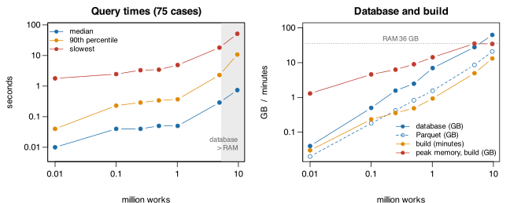

<!-- README.md is generated from README.Rmd. Please edit that file -->

```{r, include = FALSE}
knitr::opts_chunk$set(
  collapse = TRUE,
  comment = "#>",
  eval = FALSE
)
```

# openalexAPI

<!-- badges: start -->
[](https://github.com/openalexPro/openalexAPI)
[](https://github.com/openalexPro/openalexAPI/tree/main)
[](https://github.com/openalexPro/openalexAPI/actions/workflows/R-CMD-check.yaml?query=branch%3Amain)
[](https://github.com/openalexPro/openalexAPI/tree/dev)
[](https://github.com/openalexPro/openalexAPI/actions/workflows/R-CMD-check.yaml?query=branch%3Adev)
[](https://doi.org/10.5281/zenodo.24514237)
[](https://opensource.org/licenses/MIT)
[](https://openalexpro.github.io/openalexAPI/)
<!-- badges: end -->

> **Alpha.** openalexAPI works and is tested, but its functions, arguments and
> the details of its responses may still change between versions. It is not on
> the openalexPro r-universe yet; install it from GitHub.

**openalexAPI** serves a local Parquet corpus of OpenAlex works through a web
API that answers like the [OpenAlex API](https://api.openalex.org). You can run
the same queries against your own data that you run against OpenAlex: classic
`filter=` / `search=` URLs, OQL (OpenAlex Query Language), OQO (OpenAlex Query
Object), `group_by`, `sort` and paging. It also includes a small web page for
running queries in the browser.

Because the answers look like OpenAlex's, the download functions of
[openalexPro](https://github.com/openalexPro/openalexPro) work against the
local server unchanged. Point `pro_query()` at it with `endpoint =`.

The corpus can come from:

- `openalexPro::pro_request_parquet()` / `pro_fetch()` downloads
- an extraction from the OpenAlex snapshot (openalexSnapshot)
- any other source with the OpenAlex works schema

It is meant for **project-sized corpora**, not the whole snapshot.

## Installation

openalexAPI is not on the openalexPro r-universe yet. Install it from GitHub;
its dependencies, openalexPro included, come along:

```{r}
# install.packages("pak")
pak::pak("openalexPro/openalexAPI")       # main: the current alpha version
pak::pak("openalexPro/openalexAPI@dev")   # dev: the newest changes
```

Or with remotes:

```{r}
# install.packages("remotes")
remotes::install_github("openalexPro/openalexAPI")
```

## Quick start

```{r}
library(openalexAPI)

# A corpus downloaded with openalexPro, or any folder of works Parquet files
serve_corpus("my_project/parquet", port = 8000)
```

Then open <http://127.0.0.1:8000/> for the web page, or query the API:

```
http://127.0.0.1:8000/works?filter=type:article,publication_year:>2015&search=coral bleaching
http://127.0.0.1:8000/works?filter=type:article&group_by=authorships.countries
http://127.0.0.1:8000/?oql=works where type is article and year >= 2015
http://127.0.0.1:8000/works/W2741809807
```

From another R session, download a subset of the corpus with openalexPro,
exactly as from OpenAlex:

```{r}
library(openalexPro)
q <- pro_query(
  entity = "works", type = "article", search = "coral bleaching",
  endpoint = "http://127.0.0.1:8000"
)
pro_fetch(q, project_folder = "subset")
```

## How it works

```
classic URL or OQL --> OpenAlex /query (free) --> OQO --> DuckDB SQL --> OpenAlex-shaped JSON
OQO                -----------------------------^  (offline)
```

`prepare_corpus()` (run by `serve_corpus()`) reads the Parquet files into a
cached DuckDB database. The cache holds one row per work, IDs and DOIs
normalised so they match in any form, and full-text indexes over title and
abstract. OpenAlex's free `/query` endpoint translates classic URLs and OQL
into an OQO, so the query languages are exactly OpenAlex's. `oqo_to_sql()`
compiles the OQO into SQL. An OQO sent directly runs without network access.

## What is supported

- **48 works filters:** type, year and dates (also the creation date),
  language, open access, citations and percentiles, authors and ORCIDs,
  institutions (also with their lineage), countries, funders, sources, ISSNs,
  publishers, topics down to subfields, keywords, SDGs, IDs (OpenAlex, DOI,
  PMID, PMCID), `cites` and `cited_by`. AND, OR
  (`a|b`), negation (`!a`), ranges, and `null` for "field missing" all work.
- **`group_by`** on one dimension, with OpenAlex's key formats. `:include_unknown`
  is supported.
- **Full-text search** over title and abstract, with `search`, `search.exact`
  and the `<field>.search` filters, plus searches in affiliation strings and
  author names. All words must match, quoted phrases must
  appear in order, proximity (`"a"~N~"b"`, `"a b"~N`) works, and wildcards
  work with `.exact`. Results are ranked by
  `relevance_score` (BM25).
- **Records** are returned as stored, including fields that are not
  OpenAlex's. You can use `select`, `sort`, `per_page`, `page`, `cursor` and
  `sample`/`seed`, and look up single works by ID or DOI.

## Differences from OpenAlex

- **Local data:** counts come from the corpus, not from all of OpenAlex.
- **Search** covers title and abstract only, because there is no full text.
  The stemmer folds more word forms than OpenAlex's, so stemmed counts can be
  higher. Proximity allows up to N words between the terms, an approximation
  of OpenAlex's.
- **Display names:** countries, languages and licenses use the code as the
  display name in `group_by` results ("AU" rather than "Australia").
- **Unsupported features** get a clear HTTP 400 that names them: OpenAlex
  collections, semantic search, `group_by` on several dimensions, and OQL's
  comparisons and nested queries. 156 of OpenAlex's 174 OQL example queries
  run locally (`tools/oql_coverage.R`).

## Corpus size and memory



These figures come from `tools/benchmark.R` (75 queries covering every feature)
on parts of the OpenAlex snapshot, run on a Mac with 14 cores and 36 GB of RAM
(`tools/benchmark_scaling.csv`, figure by `tools/plot_scaling.R`):

| Works | Parquet | Database | Build | Median query | Slowest query | Queries > 1 s |
|---|---|---|---|---|---|---|
| 10,000 | 0.02 GB | 0.04 GB | 2 s | 0.01 s | 1.8 s | 1 of 75 |
| 100,000 | 0.18 GB | 0.5 GB | 14 s | 0.04 s | 2.5 s | 3 of 75 |
| 1 million | 1.6 GB | 7 GB | 1 min | 0.05 s | 4.9 s | 3 of 75 |
| 4.9 million | 8.6 GB | 28 GB | 5 min | 0.29 s | 18 s | 16 of 75 |
| 9.6 million | 21 GB | 63 GB | 13 min | 0.74 s | 51 s | 33 of 75 |

- **The database** (the cache built by `prepare_corpus()`) takes 3 to 7 times
  the space of the Parquet files: about 7 GB per million works.
- **Queries stay fast while the database fits in memory.** Up to a million
  works the median query takes 0.05 s whatever the size. Once the database
  is larger than the RAM (here above about 5 million works), DuckDB reads
  from disk and queries get much slower. The slowest are long searches,
  `group_by` on references or keywords, and 200 records per page with all
  fields.
- **Building** needs more memory than serving: about 14 GB at a million works.
  Larger corpora use all the RAM and write to temporary files on disk, which
  works but slows the build down.

Recommendations:

| Works | RAM | Disk for the cache | Use |
|---|---|---|---|
| up to 1 million | 16 GB | up to 10 GB | interactive, on a laptop |
| up to 5 million | 32 GB or more | up to 40 GB | interactive; heavy queries take seconds |
| about 10 million | 64–96 GB (estimate) | 70 GB | needs a server; on 36 GB, occasional queries only |

Put the cache (`cache_dir`) on a fast local SSD. The whole OpenAlex snapshot
(over 250 million works) is out of scope.

## Running on a server

`serve_corpus()` serves the API and the page from one process, so it can run
on a server for a group. Each release is published as a Docker image,
`ghcr.io/openalexpro/openalexapi`. With `docker/compose.yaml` and
`docker/Caddyfile`, a server needs only Docker and the Parquet files:
[Caddy](https://caddyserver.com) in front adds HTTPS with a free certificate.
The vignette's section "Running on a server" has the steps, plus what the
server does not do (logins, more than one request at a time).

See `vignette("openalexAPI")` for the details.
